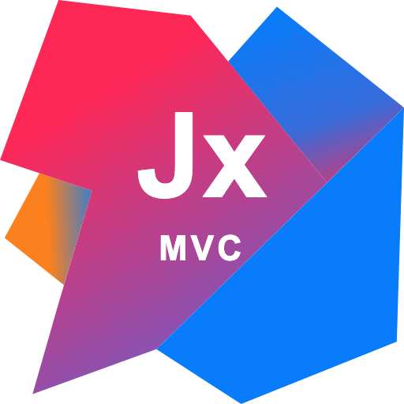

<div align="center">



# JxMVC — a 298 kB, zero-dependency MVC framework for Jakarta EE

Full-stack MVC for Jakarta EE 10 in a **298 kB JAR of 55 classes** with **zero
third-party runtime dependencies**, and **security applied by default** in a
fixed fifteen-stage request pipeline.

[](https://jxmvc.ginit.dev)
[](https://github.com/Andre031222/jxmvc/releases)
[](LICENSE)
[](https://openjdk.org/)
[](https://jakarta.ee/)
[](#design-point)
[](#reproducing-the-benchmarks)
[](#paper)
[](https://doi.org/10.5281/zenodo.21896136)

</div>

A paper describing the design, implementation and empirical evaluation of JxMVC is
in preparation. This repository holds the framework core, a demo application, and the
fully reproducible benchmark harness.

* * *

## Overview

Modern "batteries-included" JVM web frameworks trade large runtime footprints, deep
transitive-dependency trees, and broad attack surfaces for developer convenience. JxMVC
occupies a different point in the design space: it implements routing, dependency
injection, connection pooling, JSON, caching, scheduling, WebSocket, OpenAPI, metrics,
validation, rate limiting, CSRF, password hashing (PBKDF2), and a complete OAuth 2.0 /
OpenID Connect client (authorization code + PKCE, RS256/JWKS verification) **from scratch
on top of the JDK and the Jakarta Servlet API alone**.

The result is a **298 kB JAR of 55 classes with zero third-party runtime dependencies**
(the only additional production requirement is the JDBC driver of your database), small
enough to read and audit end to end.

<a name="design-point"></a>
### Design point

| Property | JxMVC | Mainstream stacks |
|---|---|---|
| Runtime dependencies | **0** | dozens to hundreds (transitive) |
| Core artifact size | **298 kB** | MB-scale |
| Security | **by default, structural** (pipeline) | opt-in (a starter you add) |
| JSON / pooling / OIDC | **own**, JDK-only | delegated to libraries |
| Readability | whole core auditable in one sitting | tracing across generated code |

Security is not a bolt-on module. In the fixed fifteen-stage pipeline, security headers,
cross-origin rejection, parameter sanitisation, body-size caps and fail-closed
authentication **precede and enclose** the developer's controller, so a newly written
controller is hardened before its author adds a single security annotation. Rate limiting
(`@JxRateLimit`) and session-token CSRF (`jxmvc.security.csrf=true`) are switched on where
the application needs them.

* * *

## Key results

Benchmarked against Spring Boot, Quarkus, Micronaut and Javalin (plus a GraalVM
native-image reference) with a single-command, containerised harness under pinned-core
isolation on **bare-metal Arch Linux** (Intel i5-12500H, 64 concurrent connections, five
30 s repetitions, medians). Run of 23 October 2026 on v3.5.0, with the same fixed 512 MB heap
for every JVM framework:

| Framework | Image (MB) | Startup (ms) | RSS (MB) | /plaintext (req/s) | /json (req/s) | /db (req/s) |
|---|---|---|---|---|---|---|
| **JxMVC** | **274.2** | 1,321 | 461.1 | 44,343 | 44,509 | 43,920 |
| Spring Boot | 302.4 | 2,574 | 504.5 | 46,450 | 47,082 | 45,925 |
| Quarkus | 298.4 | 862 | **432.6** | **50,879** | **50,439** | 49,868 |
| Micronaut | 295.0 | 1,232 | 456.9 | 47,370 | 47,371 | 42,176 |
| Javalin | 288.9 | **451** | 471.7 | 49,636 | 49,187 | **50,326** |
| _Quarkus (native)_ | _72.9_ | _13_ | _24.0_ | _49,028_ | _48,831_ | _—_ |

- **Smallest JVM-mode deployable image** of the group (about 5 % below Javalin; the shared JRE
  base dominates every image), and a cold start about twice as fast as Spring Boot.
- **Resident memory in the middle of the group**, below Spring Boot and Javalin. An earlier run
  that left each JVM to size its own heap had put JxMVC highest; with the heap fixed, that gap
  disappears.
- **Lowest throughput of the JVM group** on `/plaintext` and `/json` (5–15 % behind, every
  difference significant at p = 0.008), with tail latency in the same band (p99 3.6–3.7 ms
  against 3.3–4.1 ms). On the database-backed `/db` it overtakes Micronaut, whose rate drops
  11 % with the query; JxMVC's own `/db` cost, 1.3 %, is not significant.
- **120.9 million requests with zero errors** across the run.

Raw per-run data and the environment description live in [`benchmarks/`](benchmarks/).

### Security by default

Eighteen automated attacks against the same minimal app, every framework with its
**default configuration** (no security module added), JxMVC 3.5.0:

| | JxMVC | Spring Boot | Micronaut | Quarkus | Javalin |
|---|---|---|---|---|---|
| Protections present | **17/18** | 9/18 | 9/18 | 8/16 | 8/16 |

JxMVC adds `nosniff`, clickjacking protection, `Referrer-Policy` and a minimal CSP to every
response, rejects cross-origin `POST`s, oversized bodies, hostile and truncated JSON, open
redirects and reflected `<script>`, and never leaks exception details. The one check it does
not pass by default is login throttling: rate limiting is opt-in with `@JxRateLimit`, because
a default limit would throttle every user at once behind an unconfigured reverse proxy.
Quarkus and Javalin skip two JSON checks because their minimal apps have no JSON binding.
Full table, probes and rules: [`benchmarks/results/SECURITY.md`](benchmarks/results/SECURITY.md)
and [`benchmarks/security/`](benchmarks/security/); `./run.sh` reproduces it.

* * *

## Download and install

JxMVC is published at **<https://github.com/Andre031222/jxmvc>**. Every release is listed
under [Releases](https://github.com/Andre031222/jxmvc/releases), and every version is
archived on Zenodo under [10.5281/zenodo.21896136](https://doi.org/10.5281/zenodo.21896136) (v3.5.0:
[10.5281/zenodo.23585853](https://doi.org/10.5281/zenodo.23585853)).

One command installs the framework into your local Maven repository and, optionally, creates
a ready-to-run project. It needs JDK 17+ and Maven 3.9+; Tomcat is downloaded on first run.

```bash
# macOS / Linux
curl -fsSL https://raw.githubusercontent.com/Andre031222/jxmvc/main/install.sh | sh -s -- new myapp
```

```powershell
# Windows (PowerShell)
& ([scriptblock]::Create((irm https://raw.githubusercontent.com/Andre031222/jxmvc/main/install.ps1))) new myapp
```

```bash
cd myapp
mvn package cargo:run     # http://localhost:8080
mvn package               # target/myapp.war, deployable on Tomcat 10.1+
```

Drop `new myapp` to install only the framework. Set `JXMVC_VERSION=v3.5.1` to pin a release. The installer downloads the prebuilt `jxmvc-core-<version>.jar` from the release and installs it with `mvn install:install-file`; the same JAR is available at https://github.com/Andre031222/jxmvc/releases/latest/download/jxmvc-core.jar.

* * *

## Quick start

A controller, an entity and its repository:

```java
@JxControllerMapping("notes")
public class NoteController extends JxController {

    @JxGetMapping("/{id}")
    public ActionResult show() {
        try (JxDB db = db()) {
            return json(db.queryRow("SELECT * FROM note WHERE id = ?", model.pathVarLong("id")));
        }
    }

    @JxRequireAuth
    @JxPostMapping("/")
    public ActionResult create(@JxValid @JxBody Note note) {
        long id = new NoteRepository().save(note);
        return redirect("/notes/" + id);
    }
}

public class Note {
    @JxId public Long id;
    @JxRequired @JxMaxLength(200) public String title;
}

public class NoteRepository extends JxRepository<Note, Long> {
    public NoteRepository() { super("note", Note.class); }
}
```

Before either action runs, the pipeline has already added the security headers, rejected
cross-origin requests, sanitised the parameters and capped the request body. `@JxBody`
parses the JSON body and `@JxValid` checks it; `@JxRequireAuth` denies the request when no
authenticated user is present. Rate limiting is opt-in per action with `@JxRateLimit`, and
session-token CSRF is enabled with `jxmvc.security.csrf=true`. Live demo and docs:
<https://jxmvc.ginit.dev>.

### Build from source

```bash
git clone https://github.com/Andre031222/jxmvc.git
cd jxmvc
mvn -q -f JxMVC.Core/pom.xml install
```

* * *

## Reproducing the benchmarks

The entire comparison reproduces with a single command (Docker required). Each framework
is built into an image on the same JRE base and run under identical CPU/memory limits:

```bash
cd benchmarks/docker
./bench.sh                 # plaintext + json
BENCH_DB=1 ./bench.sh      # adds the database-backed /db endpoint
```

Results are written to [`benchmarks/results/`](benchmarks/results/) (`RESULTS-docker.md`
plus the raw per-run CSV). For publication-quality numbers, run on bare-metal Linux with
pinned cores; see [`benchmarks/docker/RUN-DB.md`](benchmarks/docker/RUN-DB.md).

The core is verified by a **425-check test suite written without any external testing
framework** — consistent with the zero-dependency principle.

* * *

## Project structure

```
.
├── JxMVC.Core/       the framework — 55 classes, zero runtime dependencies
├── JxMVC.Site/       demo web application (also powers jxmvc.ginit.dev)
├── benchmarks/       one-command Docker harness + raw results and environment
├── docs/             logo and assets
└── README.md
```

* * *

## Paper

The design decisions, from-scratch implementation experience, and empirical evaluation
are written up in a manuscript **in preparation**. The archived source is citable via Zenodo:
**[10.5281/zenodo.21896136](https://doi.org/10.5281/zenodo.21896136)**. The article
reference will be added here once available.

```bibtex
@software{jxmvc,
  author       = {Laura-Murillo, Ramiro Pedro and Vilca-Solorzano, Richar Andre and Melgarejo-Bolivar, Romel Percy and Torres-Cruz, Fred},
  title        = {JxMVC: A Security-by-Default Web Framework with Zero Third-Party Dependencies},
  year         = {2026},
  publisher    = {Zenodo},
  doi          = {10.5281/zenodo.21896136},
  url          = {https://doi.org/10.5281/zenodo.21896136}
}
```

* * *

## Authors

Listed in the order of the manuscript.

| Author | Affiliation | ORCID |
|---|---|---|
| Ramiro Pedro Laura-Murillo | Universidad Nacional de Juliaca, Peru | [0000-0003-1837-4871](https://orcid.org/0000-0003-1837-4871) |
| Richar Andre Vilca-Solorzano *(corresponding)* | Universidad Nacional del Altiplano, Puno, Peru | [0009-0003-2385-5263](https://orcid.org/0009-0003-2385-5263) |
| Romel Percy Melgarejo-Bolivar | Universidad Nacional del Altiplano, Puno, Peru | [0000-0001-9383-9136](https://orcid.org/0000-0001-9383-9136) |
| Fred Torres-Cruz | Universidad Nacional del Altiplano, Puno, Peru | [0000-0003-0834-6834](https://orcid.org/0000-0003-0834-6834) |

* * *

## License

Released under the [MIT License](LICENSE).
